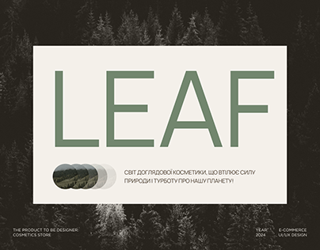

# Cosmetics store cover: giant LEAF title on a cream card over dark forest

**Discipline:** web ·  · **Design style:** Warm & Organic
**Tags:** cover, e-commerce, forest, cream-card, sage-green, sans-serif, sustainable, cyrillic

## What it is
A monochrome forest photograph with a cream rectangle in the centre. Inside, a huge sage-green 'LEAF' in light caps, a row of overlapping circles with tiny landscapes, a short Ukrainian tagline, and metadata labels in the corners.

## What it means
Calm, organic and premium; the cream card feels like a label set on nature.

## Techniques
- Place a solid cream panel over a darkened photo to create a focused title area.
- Set the brand name in enormous light caps in a muted green.
- Use overlapping circles as a subtle motif.
- Add tiny project metadata at the corners.

## Best for
- Eco and cosmetics brands
- Case-study covers
- Sustainability-oriented sites

## Vocabulary
- **Label panel** — A flat coloured rectangle laid over an image for text.
- **Overlapping circles** — A row of intersecting round shapes as a motif.
- **Muted green** — A soft grey-green suggesting nature.
- **Title card** — A slide containing just the project name.
