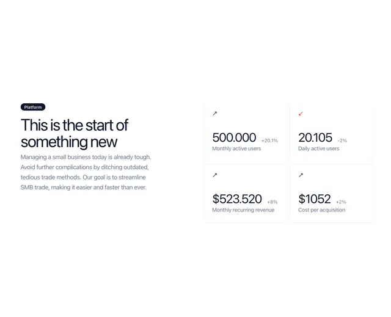

# Section with a dark 'Platform' pill and headline beside a 2x2 grid of KPI cards showing values, deltas and arrows

**Discipline:** web · **Design type:** UI components
**Tags:** component, kpi, stats, white, arrows, tight-headline, cards, saas

## What it is
A white page with a dark pill 'Platform', a tightly tracked headline 'This is the start of something new', a grey paragraph and a 2x2 grid of soft-shadow cards, each with a small arrow (dark up, red down), a big figure (500.000, 20.105, $523.520, $1052), a green or red delta and a grey label.

## What it means
Confident and clean; large numbers with small deltas read as a quick pulse of the business.

## Techniques
- Use a tight negative-tracked headline.
- Show KPIs as large numerals with small deltas.
- Encode direction with arrow colour.
- Use soft-shadow white cards.

## Best for
- SaaS metric sections
- Investor and product pages
- KPI card components

## Vocabulary
- **KPI card** — A card presenting one metric.
- **Delta** — A small change indicator such as +8%.
- **Tight tracking** — Letter spacing reduced for a dense headline.
- **Category pill** — A small dark capsule labelling a section.
