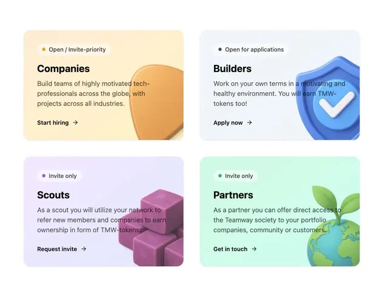

# Pastel role cards (Companies, Builders, Scouts, Partners) with status pills, short copy, action links and 3D objects

**Discipline:** web ·  · **Design style:** 3D & Surreal
**Tags:** cards, pastel, status-pills, 3d-icons, peach, blue, lilac, mint

## What it is
A 2x2 grid of rounded cards in peach, pale blue, lilac and mint, each with a small pill with a coloured dot (Open / Invite-priority, Open for applications, Invite only), a bold role title, a short paragraph, a bold action link with an arrow (Start hiring, Apply now, Request invite, Get in touch) and a 3D object at the right edge (a guitar-pick shape, a blue shield with a tick, purple cubes, a globe with a sprout).

## What it means
Friendly and clear; soft colour and 3D icons sort audiences without heaviness.

## Techniques
- Give each audience a pastel colour.
- Use status pills with coloured dots.
- Place a 3D icon at the right edge.
- Keep one bold action link per card.

## Best for
- Community and platform role selectors
- Pastel card grids
- Audience segmentation sections

## Vocabulary
- **Status pill** — A capsule with a dot and a state label.
- **Role card** — A card describing a type of participant.
- **Edge 3D icon** — A rendered object bleeding off the card edge.
- **Action link** — A bold link with an arrow.
