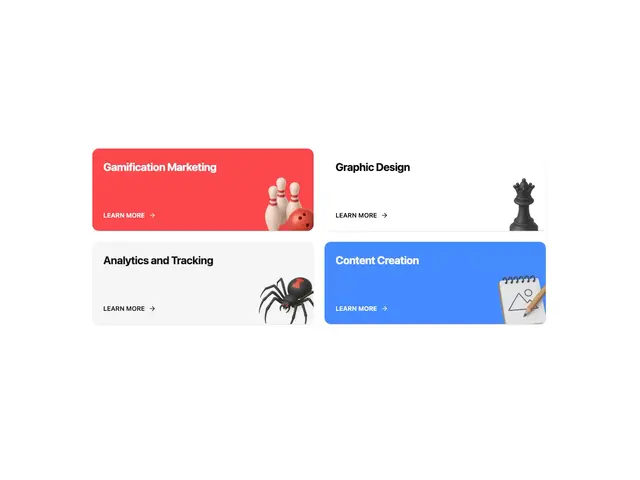

# Two-by-two service cards in red, white, grey and blue with 3D objects: bowling pins, chess queen, spider and notepad

**Discipline:** web ·  · **Design style:** 3D & Surreal
**Tags:** services, cards, red, blue, 3d-icons, learn-more, grid, colour-block

## What it is
A 2x2 grid of rounded cards: a red 'Gamification Marketing' with bowling pins and a ball, a white 'Graphic Design' with a black chess queen, a light grey 'Analytics and Tracking' with a black widow spider and a blue 'Content Creation' with a notepad and pencil, each with a bold title at the top left, a small LEARN MORE arrow link at the bottom left and a 3D object cropped at the bottom right.

## What it means
Bold and witty; each 3D object is a visual pun for the service.

## Techniques
- Use one 3D metaphor object per card.
- Crop the object at the bottom corner.
- Colour-block cards in red and blue with white and grey.
- Repeat a small learn-more link.

## Best for
- Agency service grids
- 3D metaphor cards
- Colour-block layouts

## Vocabulary
- **Metaphor object** — A 3D item standing for a service.
- **Cropped corner object** — An illustration cut by the card's corner.
- **Colour-block cards** — Cards in saturated flat colours.
- **Learn-more link** — A small caps link with an arrow.
