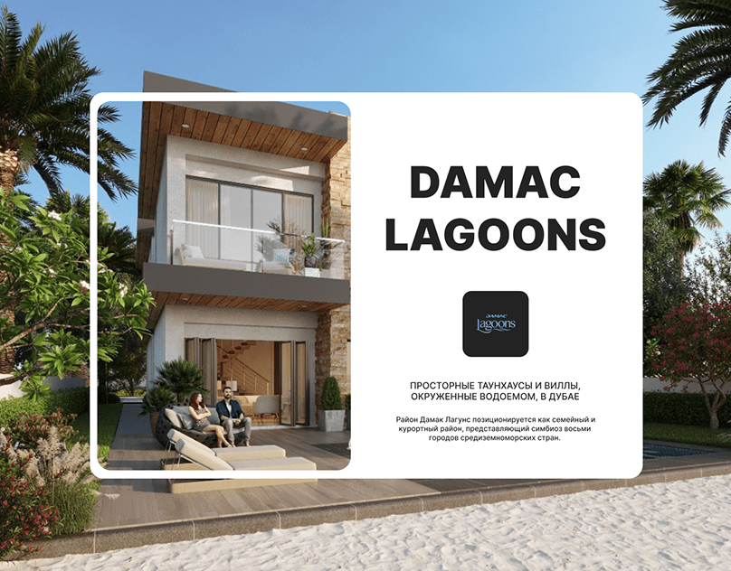

# White rounded card holding a villa photo and centred title over a beach house background

**Discipline:** web ·  · **Design style:** Geometric & Bauhaus
**Tags:** real-estate, card-over-photo, white-card, rounded, bold-title, dubai, cyrillic, cover

## What it is
A full-bleed photo of a palm-lined beach house with a large white rounded rectangle on top. The left of the card holds a rounded photo of a villa terrace with a couple; the right has a heavy black centred title 'DAMAC LAGOONS', a dark app-style logo tile and two short paragraphs.

## What it means
Clean and aspirational; the white card imposes order over a busy holiday scene.

## Techniques
- Lay a white card over a full-bleed photo to hold text.
- Repeat the same imagery inside the card at rounded scale.
- Centre a heavy caps title with a logo tile beneath.
- Keep body text small and centred.

## Best for
- Property development and travel covers
- Web project covers with a strong photo
- Marketing one-pagers

## Vocabulary
- **Card-over-photo** — A solid card placed on a full-bleed image.
- **Logo tile** — A rounded square holding a logo.
- **Centred stack** — Title, logo and text aligned on the centre.
- **Photo repeat** — Using the same image at two scales.
