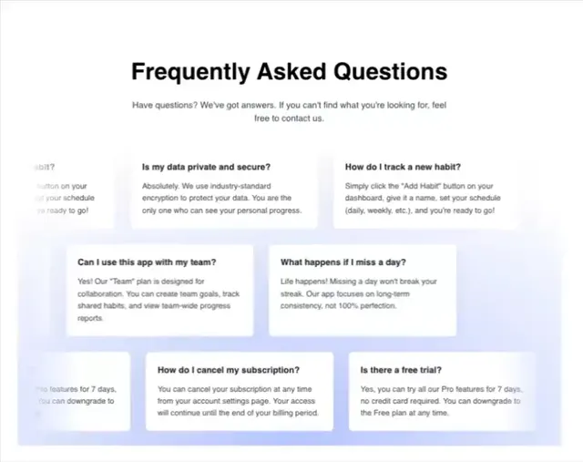

# 'Frequently Asked Questions' as staggered white answer cards in three rows, cropped at the edges over a soft lilac haze

**Discipline:** web ·  · **Design style:** Playful & Illustrated
**Tags:** faq, cards, staggered, lilac, haze, white, habit-app, question-answer

## What it is
A white page with a bold centred heading and grey paragraph above three rows of small white shadowed cards of bold questions with grey answers, offset from each other and cropped at the sides, over a soft blue-lilac cloud gradient behind.

## What it means
Friendly and airy; an offset card wall makes FAQs feel like sticky answers.

## Techniques
- Show questions and answers as small cards.
- Offset rows and crop edges.
- Use a soft haze behind.
- Keep bold questions and grey answers.

## Best for
- FAQ sections with personality
- Habit and productivity apps
- Card-wall layouts

## Vocabulary
- **Answer card** — A small card with a question and answer.
- **Offset rows** — Rows shifted horizontally.
- **Cloud haze** — A soft blurred colour behind cards.
- **Edge crop** — Cards cut by the frame.
