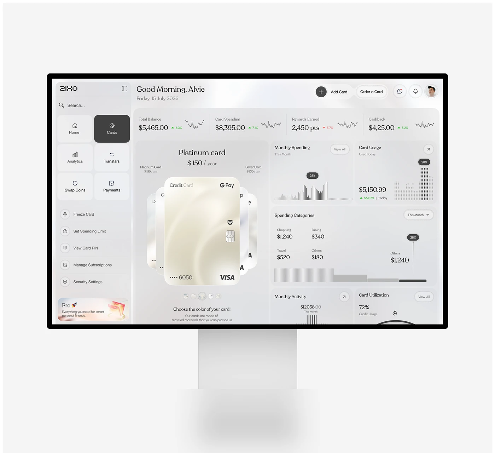

# Frosted Card Management Dashboard

**Discipline:** web · **Design type:** Dashboard
**Tags:** dashboard, monitor, frosted, cards, grey, banking, charts

## What it is
A pale monitor showing a grey frosted banking dashboard with a tile sidebar, KPI strip with sparklines, a fan of pearlescent cards with a large platinum card, dotted and striped bar charts, spending categories and card utilisation.

## What it means
Pearl, grey and black keep a data-heavy page calm, and the platinum card is a clear focal point.

## Techniques
- Card fan with one large card in front
- Dot-matrix bars and stripe bars as chart textures
- Serif numerals for balances
- Black active tile in the sidebar
- Pro upsell card at the base of the sidebar

## Best for
- Card management dashboards
- Monochrome fintech UI
- Premium banking products

## Vocabulary
- **Sparkline** — A tiny line chart shown beside a figure.
- **Dot-matrix bar** — A bar made of tiny dots.
- **Upsell card** — A card promoting a paid upgrade.
