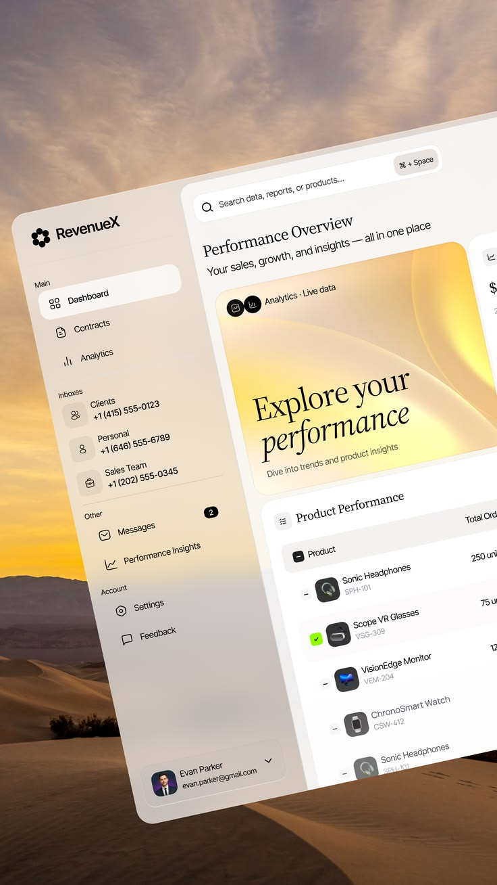

# Frosted Dashboard Tilted over Desert

**Discipline:** web · **Design type:** Dashboard
**Tags:** dashboard, desert, sunset, frosted, serif, tilted, gold

## What it is
A cream, frosted-glass analytics dashboard tilted steeply over a golden-hour desert photo, with a serif 'Explore your performance' banner, sidebar and product table.

## What it means
Warm sky and dune tones make data feel calm and premium. The serif headline adds editorial warmth to a business tool.

## Techniques
- Frosted panel blending into a photo background
- Serif headline inside a sans-serif UI
- Steep perspective tilt with cropped edges
- Yellow gradient banner echoing the sunset
- Rounded nested cards with soft shadows

## Best for
- Analytics and CRM products
- Premium SaaS marketing images
- Vertical story or Pinterest formats

## Vocabulary
- **Frosted panel** — A translucent blurred surface showing the background.
- **Type pairing** — Combining a serif and a sans-serif for contrast.
- **Perspective tilt** — Rotating a flat UI in 3D space.
