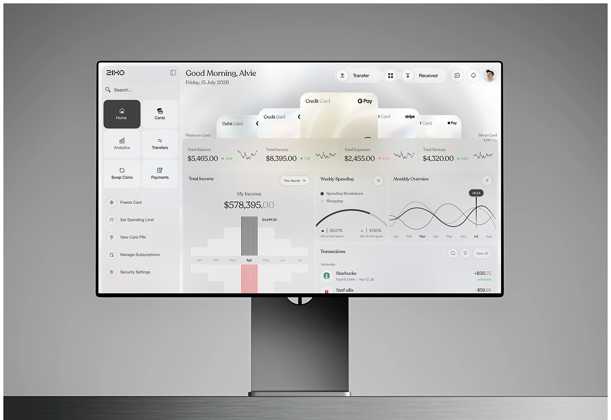

# Frosted Glass Banking Dashboard on Monitor

**Discipline:** web · **Design type:** Device mockup scene
**Tags:** monitor, dashboard, glass, grey, cards, banking, pearl

## What it is
A tall monitor on a grey studio ground showing a frosted banking dashboard where pearlescent credit cards fan out above KPI strips, income bar chart, spending arc, monthly wave chart and a transactions list, with a tile sidebar.

## What it means
Pearl and frost tones feel luxurious and calm, and fanned cards make the cards the visual centre.

## Techniques
- Pearlescent cards fanned at the top of the dashboard
- Glass panels with blurred overlaps
- Vertical bar chart with one dark and one red bar
- Tile sidebar with icons
- Monitor on a dark tabletop against grey

## Best for
- Premium banking dashboards
- Glassmorphism desktop UI
- Monitor mockups

## Vocabulary
- **Pearlescent** — A soft iridescent sheen like a pearl.
- **Card fan** — Cards overlapped in an arc.
- **Tile sidebar** — A navigation sidebar built of square tiles.
