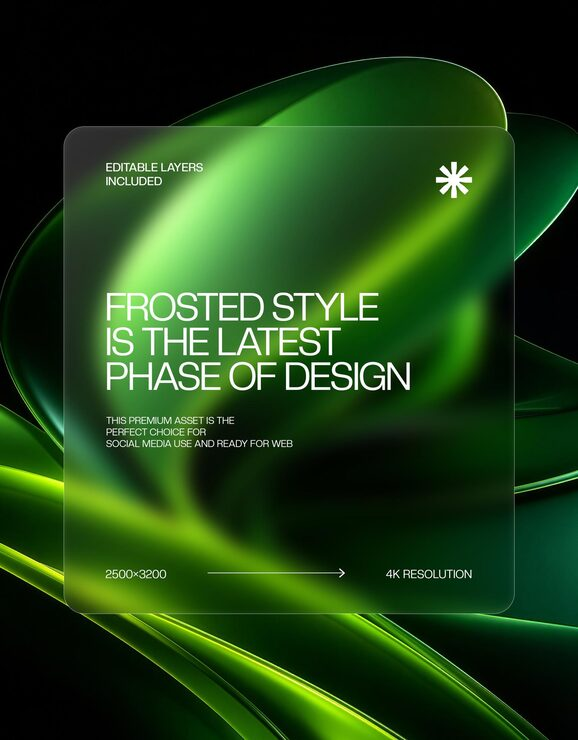

# 'Frosted Style Is The Latest Phase of Design' card over glowing green wavy ribbon shapes

**Discipline:** web · **Design type:** Background pattern · **Design style:** Glassmorphism
**Tags:** glassmorphism, green, frosted-glass, wavy-ribbon, dark, template

## What it is
A dark background with glowing green wavy ribbon shapes flowing diagonally, overlaid by a large frosted-glass rounded rectangle card with white text stating the design trend, an asterisk icon, resolution and dimension labels, and an arrow indicating scale.

## What it means
Premium and on-trend; a frosted glass card over a glowing ribbon shows the glassmorphism effect in its ideal habitat.

## Techniques
- Layer a frosted glass card over a vivid glowing background.
- Label technical specs (resolution, dimensions) directly on a template asset.
- Use flowing ribbon shapes to give a glass card something to refract.

## Best for
- Glassmorphism UI templates
- Design asset marketplaces
- Dark-mode background design

## Vocabulary
- **Frosted glass card** — A translucent blurred panel mimicking textured glass.
- **Wavy ribbon shape** — A flowing curved band used as a background element.
