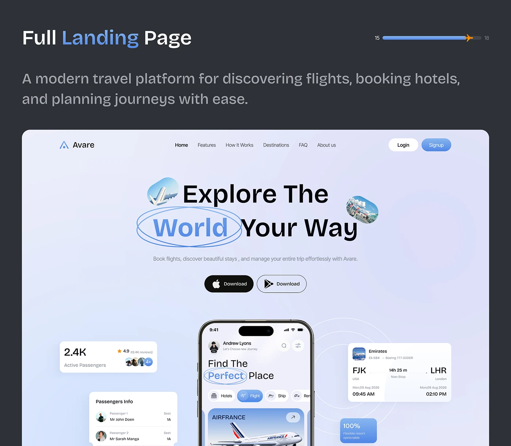

# Travel Landing Hero with Floating Info Cards

**Discipline:** web · **Design type:** Landing page hero
**Tags:** landing, travel, circled-word, floating-cards, lavender, blue, phone, dark-frame

## What it is
A dark slate slide titled Full Landing Page with a plane progress bar, and a lavender travel landing page with a nav and Login and Signup buttons, a headline 'Explore The World Your Way' with a circled word and small photo pills, store download buttons, and a centred phone surrounded by floating cards for passengers, flight details and stats.

## What it means
Floating info cards around a central phone show the product's range, and small photo pills in the headline add life.

## Techniques
- Circled word and inline photo pills in the headline
- Floating cards around a centre phone
- Concentric rings behind the phone
- Dark and light store buttons side by side
- Blue gradient signup pill

## Best for
- Travel landing page heroes
- Landing page presentations
- Hero sections with floating UI

## Vocabulary
- **Photo pill** — A small rounded photo placed inline in a headline.
- **Floating UI card** — A card of interface detail floating near a device.
- **Ring backdrop** — Concentric circles behind a hero.
