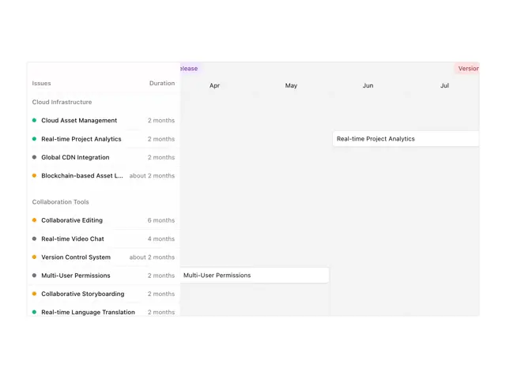

# Roadmap timeline: left list of grouped issues with coloured status dots and durations, and month columns with white bars

**Discipline:** web · **Design type:** UI components
**Tags:** component, timeline, gantt, roadmap, status-dots, white, grey, project-management

## What it is
A pale panel with a left table (Issues, Duration) grouped under Cloud Infrastructure and Collaboration Tools with green, grey and orange dots, and a right area of month columns (Apr to Jul) with white rounded bars at positions plus small purple and red release labels at the edges.

## What it means
Orderly and readable; dots and bars keep a plan calm.

## Techniques
- Group rows under section labels.
- Use small status dots.
- Place labelled bars on month columns.
- Tint release tags in soft colours.

## Best for
- Product roadmap and timeline components
- Project management UI
- Gantt visualisations

## Vocabulary
- **Roadmap** — A timeline of planned work.
- **Status dot** — A coloured dot marking state.
- **Grouped rows** — Rows organised under section headings.
- **Release tag** — A small label marking a version date.
