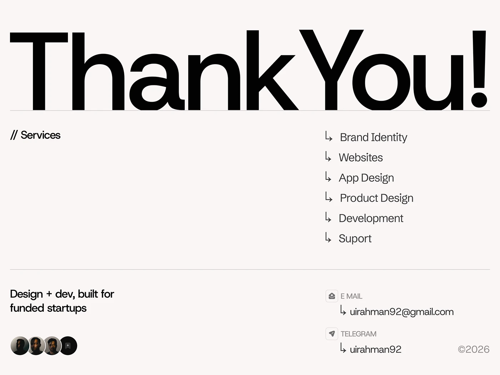

# Giant Thank You with Services List

**Discipline:** web · **Design type:** Closing banner
**Tags:** thank-you, giant-type, black, white, services, contact, arrows, minimal

## What it is
An off-white slide with a full-width black 'Thank You!' in heavy grotesque type sitting on a hairline, a Services heading at left with a right-side list of six services preceded by return arrows, and a footer with a studio line, avatars, email and Telegram contacts and a copyright year.

## What it means
Enormous type makes a confident sign-off, and arrows and hairlines make the details feel structured.

## Techniques
- Full-width giant heavy title
- Return-arrow bullets for lists
- Hairlines dividing sections
- Overlapping avatar circles
- Two-column footer of contact details

## Best for
- Studio and portfolio closing slides
- Contact and services summaries
- Typographic sign-offs

## Vocabulary
- **Giant title** — A headline set at the full width of the canvas.
- **Arrow bullet** — An arrow used in place of a list dot.
- **Avatar row** — Overlapping circular portraits of a team.
