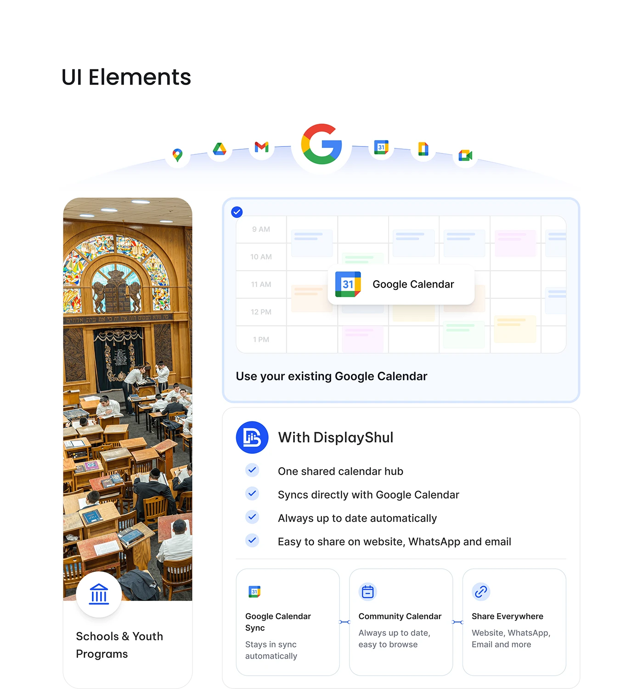

# Feature block: Google icon arc, calendar preview, tick list and a synagogue photo card

**Discipline:** web ·  · **Design style:** Playful & Illustrated
**Tags:** feature-section, white, blue, google, checklist, photo-card, integration, cards

## What it is
A white 'UI Elements' page with a Google-app icon arc leading to a large G, a tall rounded photo of a synagogue with a round icon and label, a light-blue calendar card highlighting Google Calendar, and a white card with tick items and three small feature tiles linked by arrows.

## What it means
Clear and trustworthy; familiar logos and tick lists make integration easy to grasp.

## Techniques
- Arrange partner icons in an arc around a hero logo.
- Combine a tall documentary photo with UI cards.
- Highlight one card with a blue border.
- Use tick circles for benefits.

## Best for
- Integration and feature sections
- Community and organisation tools
- Light SaaS pages

## Vocabulary
- **Icon arc** — Icons placed along a curve.
- **Highlight card** — A card with a coloured border to stand out.
- **Tick list** — Benefits marked with check circles.
- **Feature tile** — A small card explaining one capability.
