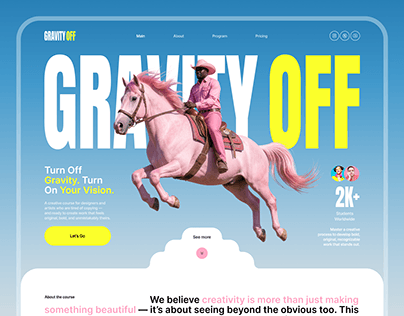

# Sky-blue course site with giant 'GRAVITY OFF' white and yellow, a leaping pink horse and rider, and a cloud-shaped section edge

**Discipline:** web · **Design type:** Landing page hero
**Tags:** course, sky-blue, yellow, pink, giant-type, cutout, cloud, playful

## What it is
A blue gradient hero inside a rounded frame with a nav, huge heavy 'GRAVITY' in white and 'OFF' in yellow, a cutout of a pink horse leaping with a rider in pink, a tagline with pink keywords, a yellow Let's Go button, student avatars with '2K+', a cloud-shaped notch and a white About section with pink emphasis.

## What it means
Whimsical and bold; a leaping horse is the literal 'gravity off'.

## Techniques
- Let a cutout break the giant headline.
- Colour half the title yellow.
- Use a cloud shape as a section edge.
- Highlight words in pink.

## Best for
- Creative course and workshop sites
- Surreal cutout heroes
- Blue-yellow-pink palettes

## Vocabulary
- **Title break** — A cutout overlapping and interrupting a headline.
- **Cloud edge** — A cloud-shaped boundary between sections.
- **Two-colour headline** — A headline with words in different colours.
- **Avatar counter** — Small avatars beside a count.
