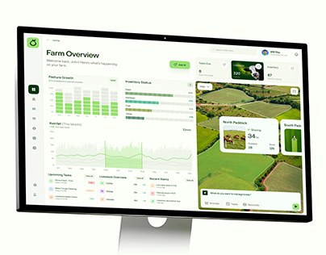

# Green Farm Dashboard on Monitor

**Discipline:** web ·  · **Design style:** Corporate & Clean-Tech
**Tags:** dashboard, green, farm, monitor, aerial-map, charts, cover

## What it is
A cover with a white desktop monitor showing a farm management dashboard: pasture growth bars, rainfall chart, task lists and a large aerial farm map with paddock cards, all in fresh greens.

## What it means
Aerial fields and green charts tie data to the land, making a technical tool feel natural and approachable.

## Techniques
- Aerial imagery as the dominant right-hand panel
- Green tint across all charts to match the subject
- Clean white monitor on a white background for simplicity
- Small overlay cards on the map for key stats
- AI prompt bar at the bottom of the map

## Best for
- Agriculture and sustainability tools
- Dashboard case-study covers
- Data products with a geographic element

## Vocabulary
- **Aerial map panel** — A satellite or drone view used as a dashboard hero.
- **Overlay stat card** — A small card floating over a map showing local data.
- **Thematic tint** — Colouring UI to match the subject matter.
