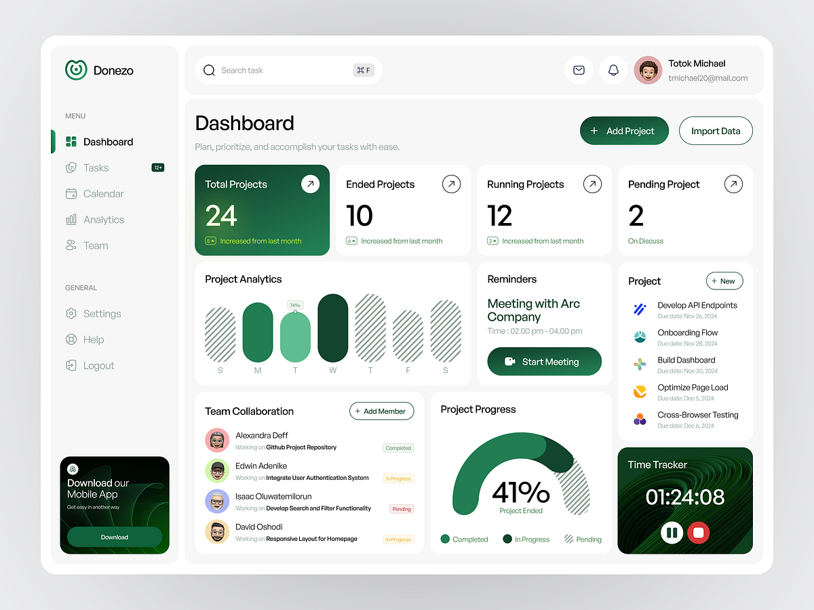

# Green Project Management Dashboard

**Discipline:** web ·  · **Design style:** Corporate & Clean-Tech
**Tags:** dashboard, green, white, hatched-bars, progress-arc, kpi, time-tracker

## What it is
A rounded white dashboard with a sidebar (menu, general, download app card), a search bar and profile, four KPI cards (a dark green Total Projects card and three white), a pill bar chart with hatched bars, a reminders card with a Start Meeting button, a project list, team collaboration with status pills, a hatched progress arc chart and a dark green time tracker.

## What it means
Hatched bars and arcs give charts texture, and deep green with white feels calm and productive.

## Techniques
- Pill-shaped hatched bars
- Half-ring progress arc with hatched pending segment
- One dark green KPI card among white
- Dark time tracker card with a wave texture
- Status pills in soft semantic colours

## Best for
- Project management dashboards
- Green and white data UI
- Hatched chart textures

## Vocabulary
- **Hatched fill** — A diagonal-line pattern used to mark unfinished or secondary data.
- **Progress arc** — A half-ring chart showing completion.
- **KPI card** — A card showing a key metric and change.
