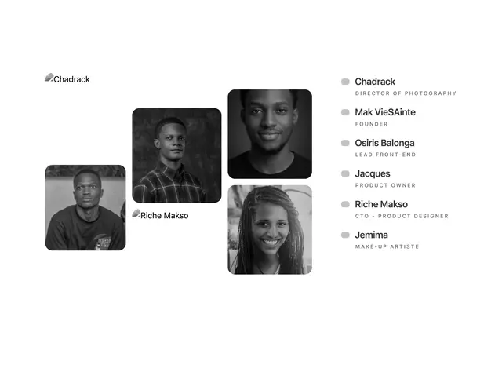

# Team section with four staggered greyscale portrait tiles at the left and a list of six names with tracked caps roles at the right

**Discipline:** web ·  · **Design style:** Photographic & Cinematic
**Tags:** team, greyscale, portraits, staggered, list, white, minimal, caps-roles

## What it is
A white page with four rounded black-and-white portraits at staggered heights, two with broken image alt text overlaying, and at the right a vertical list of six people, each with a small grey marker, a medium sans name and a wide-tracked grey caps role (Director of Photography, Founder, Lead Front-End, Product Owner, CTO - Product Designer, Make-Up Artiste).

## What it means
Editorial and calm; staggered greyscale tiles and a tracked list feel like a credits page.

## Techniques
- Stagger portrait tiles in a loose collage.
- Convert to greyscale.
- Pair with a clean name list.
- Track role captions widely.

## Best for
- Team and credits pages
- Photography and film studios
- Monochrome collages

## Vocabulary
- **Staggered tiles** — Tiles placed at different heights.
- **Credits list** — A list of names with roles.
- **Tracked caps** — Uppercase text with wide letter spacing.
- **Greyscale collage** — A black-and-white arrangement of photos.
