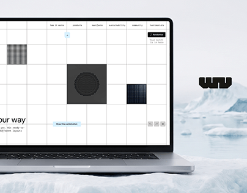

# Grid Configurator Laptop on Ice

**Discipline:** web · **Design type:** Project cover
**Tags:** laptop, ice, grid, monochrome, logo, cover

## What it is
A project cover with a laptop showing a bordered-grid site with tile textures, resting on ice, and a black blocky monogram at right.

## What it means
Cool white ice and a stark grid feel clean and technical, while the tile textures hint at material variety.

## Techniques
- Location photography matched to the concept (ice for a clean product)
- Site's gridlines echoed in the scene's calm structure
- Black stencil-like logo as a counterweight
- Cropped laptop to focus on the interface
- Monochrome scheme with tiny blue accent

## Best for
- Portfolio project covers
- Product configurators
- Sustainable or material brands

## Vocabulary
- **Project cover** — The thumbnail that represents a case study.
- **Concept backdrop** — A setting chosen to express the product's idea.
- **Grid interface** — A UI built on visible cell borders.
