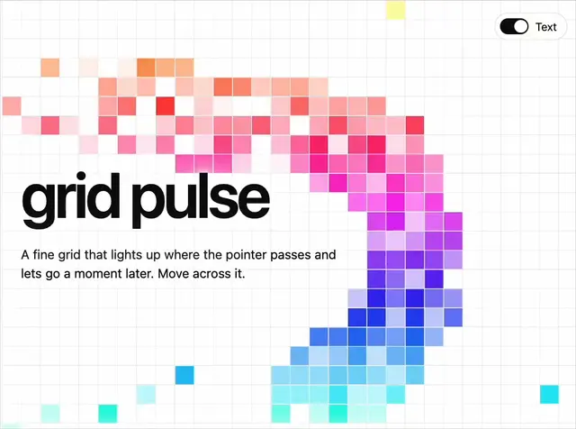

# White fine grid where squares light up in orange, pink, violet, blue and cyan along the pointer's path, under the heading 'grid pulse'

**Discipline:** web · **Design type:** Background pattern
**Tags:** interactive, grid, gradient, trail, white, pixel, heading, toggle

## What it is
A white page with a fine hairline grid whose cells light in a sweeping arc from orange through red, magenta, violet and blue to cyan and fade out behind the pointer, with a huge black 'grid pulse' heading, a paragraph explaining the effect and a small Text toggle at the top right.

## What it means
Playful and tactile; a colour trail on a quiet grid rewards moving the cursor.

## Techniques
- Light grid cells along the pointer path.
- Fade them out over time.
- Shift hue along the trail.
- Overlay a bold heading.

## Best for
- Interactive hero backgrounds
- Creative developer portfolios
- Pixel-grid effects

## Vocabulary
- **Pointer trail** — Colour left behind by the cursor.
- **Grid pulse** — Cells lighting up and fading in a grid.
- **Hue sweep** — A gradual shift of hue along a path.
- **Fine grid** — A grid of small hairline cells.
