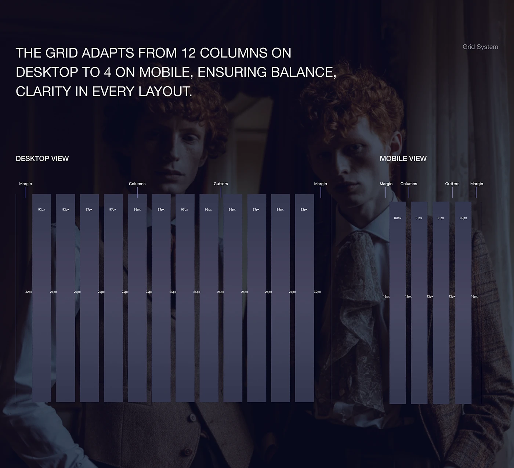

# Column grid spec with desktop and mobile bars over a darkened portrait

**Discipline:** web · **Design type:** Design system documentation
**Tags:** grid-system, documentation, dark, columns, gutters, portrait-backdrop, uppercase, fashion

## What it is
A darkened photo of two pale red-haired figures in vintage clothing sits behind a spec. An uppercase statement explains a 12-column desktop and 4-column mobile grid, then translucent vertical column bars show margins, gutters and pixel widths with small labels.

## What it means
Precise and moody; overlaying the grid on an editorial image makes an abstract rule feel cinematic.

## Techniques
- Draw the layout grid as translucent bars over a dark photo.
- Label margins, columns and gutters with hairline pointers.
- Show desktop and mobile side by side.
- Use an uppercase statement to summarise the rule.

## Best for
- Design-system grid documentation
- Fashion and editorial brand systems
- Dark technical spec pages

## Vocabulary
- **Column grid** — A set of vertical columns organising a layout.
- **Gutter** — The space between columns.
- **Margin** — The outer space beyond the columns.
- **Overlay spec** — Technical annotations placed on top of an image.
