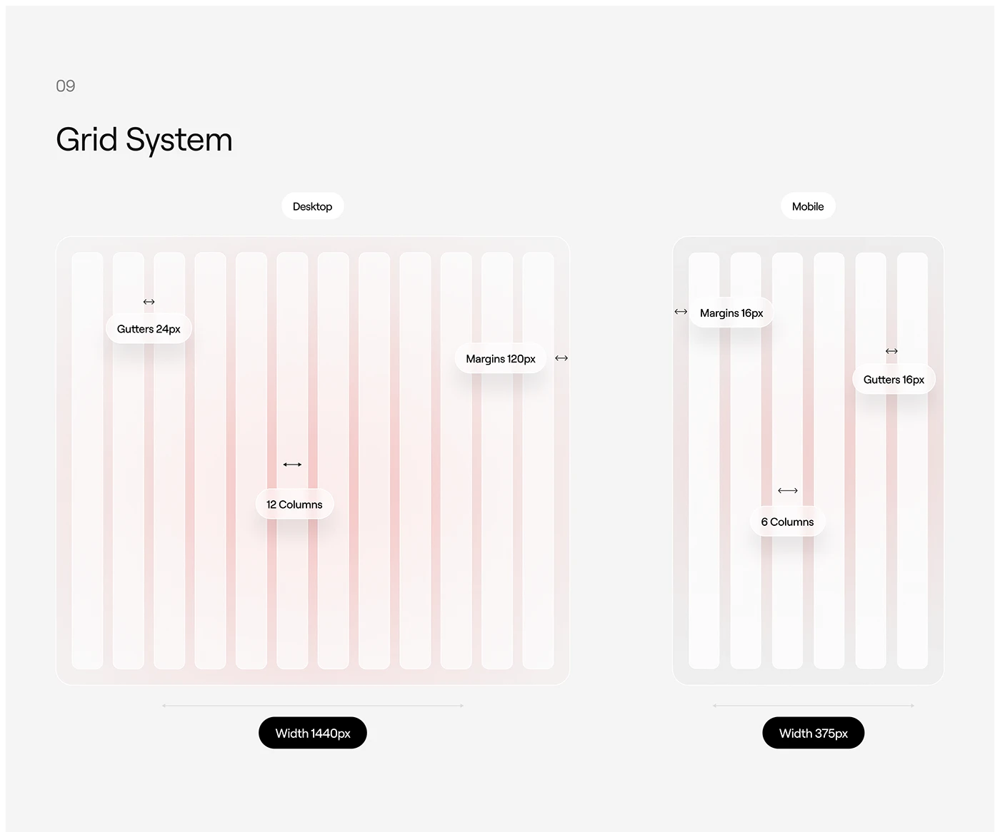

# Grid system page with soft blush columns and floating pill measurements

**Discipline:** web · **Design type:** Design system documentation
**Tags:** grid-system, documentation, light-grey, blush, pill-labels, columns, desktop-mobile, minimal

## What it is
A light grey page titled Grid System with two rounded frames, desktop and mobile, each holding pale vertical columns tinted with a soft pink glow. White pill labels float over them naming gutters, margins and column counts, with black pills giving the widths (1440px and 375px).

## What it means
Calm and easy to understand; the soft glow turns dry specs into a gentle visual.

## Techniques
- Show columns as rounded translucent bars on a pale frame.
- Label measurements with white pills and small double arrows.
- Use black pills for the total widths.
- Add a faint coloured glow behind the columns.

## Best for
- Design-system grid documentation
- Responsive spec pages
- Minimal light-mode handoff docs

## Vocabulary
- **Column bar** — A vertical strip representing one grid column.
- **Measurement pill** — A capsule labelling a size such as a gutter.
- **Width tag** — A dark pill stating the frame width.
- **Soft glow** — A faint coloured bloom behind elements.
