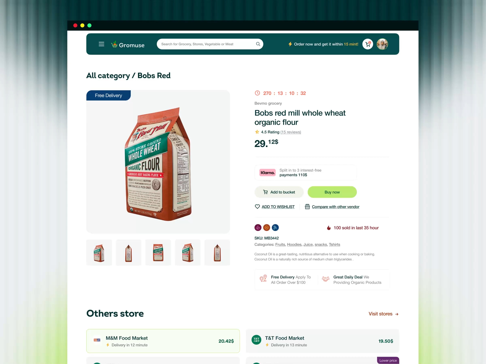

# Grocery Product Detail with Store Comparison

**Discipline:** web · **Design type:** E-commerce
**Tags:** ecommerce, grocery, teal, lime, product-page, comparison, urgency

## What it is
A product page in a macOS window frame: deep teal rounded header with search, a large product image on a pale tile with thumbnails, price with superscript cents, Klarna row, lime Buy now button, urgency countdown and a list comparing stores by price and delivery time.

## What it means
Deep teal with lime feels fresh and food-related, while the dense but ordered layout signals a fast, practical marketplace.

## Techniques
- Superscript decimals on prices for a distinct numeric style
- Lime pill CTA as the loudest element against teal and white
- Countdown and sold-recently badges for urgency
- Store comparison rows that put price and delivery time side by side
- Rounded pale tile behind the product image

## Best for
- Grocery and delivery marketplaces
- Price-comparison shops
- Any product page needing trust and urgency cues

## Vocabulary
- **Superscript price** — Cents set small and raised beside the dollar amount.
- **Urgency cue** — Countdowns or sales counters encouraging a quick decision.
- **Vendor comparison** — Rows comparing sellers on price and delivery.
