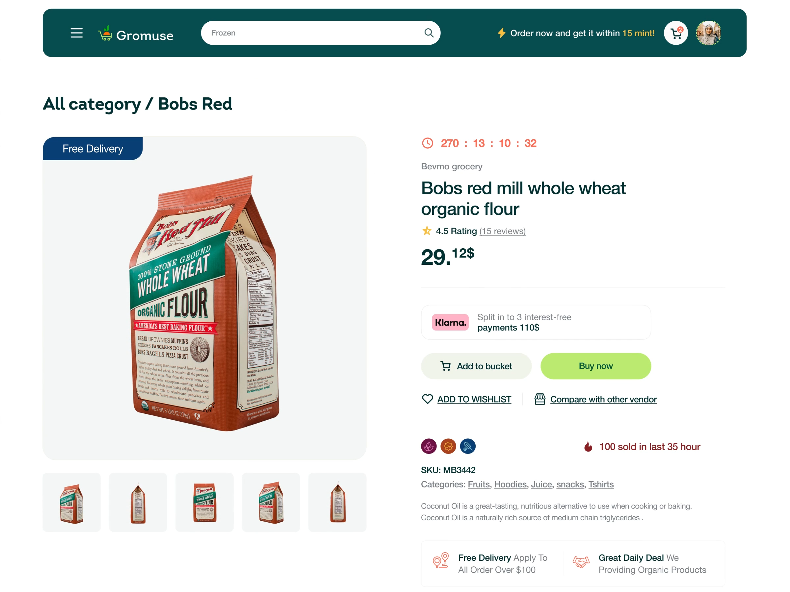

# Product Page with Large Package Tile

**Discipline:** web ·  · **Design style:** Geometric & Bauhaus
**Tags:** ecommerce, product-page, teal, lime, badges, gallery, grocery

## What it is
A full-width product page under a teal header: breadcrumb-style title, a big rounded tile showing a flour bag with a 'Free Delivery' tab, five thumbnails, a countdown, title, rating, superscript price, installment strip, add-to-cart and lime Buy now buttons, badges and delivery notes.

## What it means
Big imagery, a clear price and one bright button guide the user quickly to purchase, while small details support trust.

## Techniques
- Corner tab badge on the image tile
- Thumbnail strip beneath the main image
- Price in bold with small raised decimals
- Secondary neutral button next to the lime primary
- Icon-led reassurance row at the bottom

## Best for
- Product detail pages
- Grocery and consumer goods shops
- Conversion-focused layouts

## Vocabulary
- **Corner tab** — A label attached to the corner of an image.
- **Primary/secondary pair** — A bright main button beside a muted alternative.
- **Trust row** — Icons and short lines that reassure about delivery or deals.
