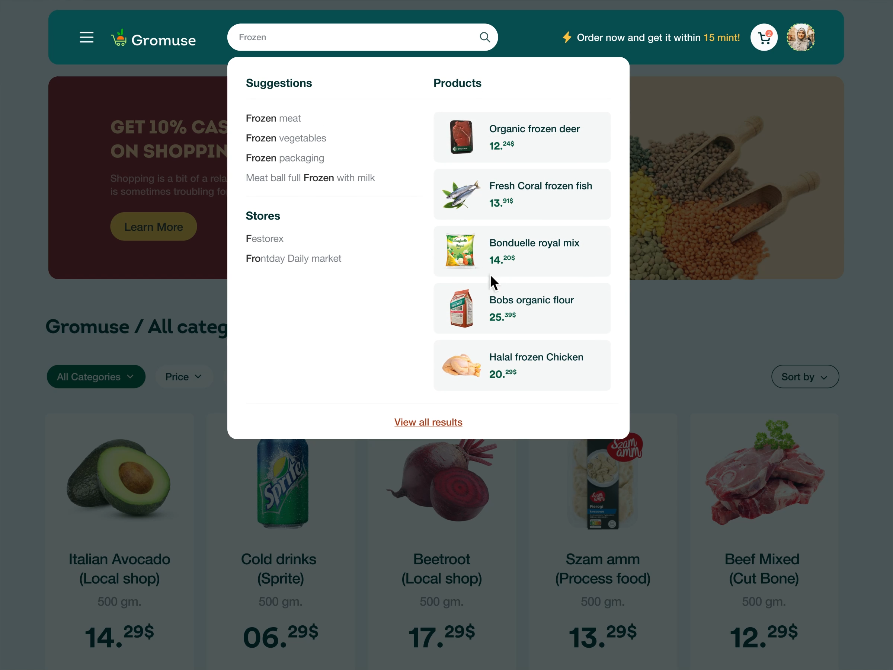

# Search Suggestion Dropdown over Product Grid

**Discipline:** web · **Design type:** E-commerce
**Tags:** search, autocomplete, dropdown, ecommerce, dimmed, teal, product-grid

## What it is
A grocery site with the search bar active: a wide white dropdown over a dimmed page lists suggestions and stores on the left and product results with images and prices on the right, above a grid of large product cards.

## What it means
Showing products as you type shortens the path to purchase, and the dimmed page focuses attention on the results.

## Techniques
- Two-column dropdown separating text suggestions from rich product results
- Bolding the matched part of each suggestion
- Dim overlay behind the panel
- Tinted rows for product results with thumbnail and price
- View all results link as the exit

## Best for
- Search-heavy catalogs
- Grocery and marketplace apps
- Any site where discovery drives conversion

## Vocabulary
- **Autocomplete** — Suggestions that appear while typing a query.
- **Rich results** — Search results that include images and prices, not just text.
- **Match emphasis** — Highlighting the typed part of a suggestion.
