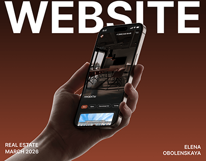

# Real-estate mobile site held in a hand under a giant WEBSITE title on a rust gradient

**Discipline:** web ·  · **Design style:** Gradient & Aurora
**Tags:** project-cover, real-estate, hand, rust, gradient, white-type, mobile-site, caps-title

## What it is
A rust-brown to red gradient with a huge white 'WEBSITE' at the top edge, a hand holding an angled phone showing a dark interiors site, and small caps captions for category, date and designer at the lower corners.

## What it means
Bold and simple; the warm gradient and giant word make a strong thumbnail.

## Techniques
- Set an oversized white caps word at the top of the frame.
- Hold the phone at an angle in a hand from below.
- Use a monochrome warm gradient as the background.
- Put credits in tiny caps at the corners.

## Best for
- Web project covers
- Portfolio thumbnails
- Property and interiors sites

## Vocabulary
- **Giant caps title** — A huge uppercase word used as the main graphic.
- **Rust gradient** — A gradient of brown to red.
- **Hand-in-frame** — A hand holding the device from below.
- **Credit caps** — Small uppercase credit text.
