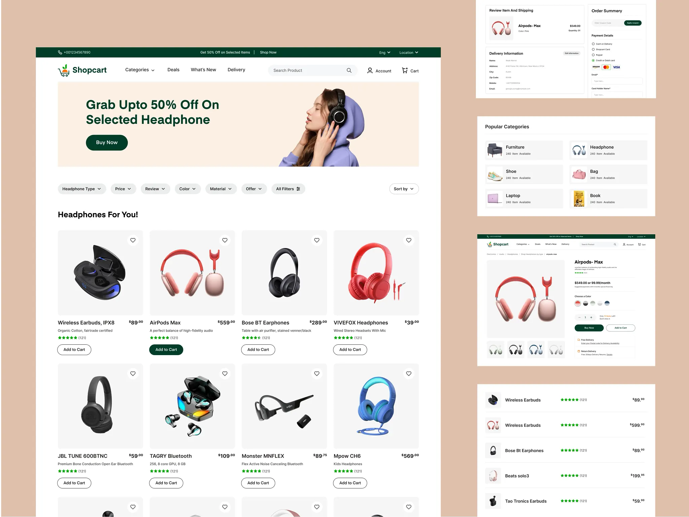

# Green-and-cream e-commerce for headphones: peach banner with green button, filter pills, product grid and small checkout and category tiles

**Discipline:** web · **Design type:** E-commerce storefront
**Tags:** e-commerce, green, peach, cream, product-grid, filters, checkout, categories

## What it is
A tan board with a large white store page under a dark green top bar: logo, nav and search, a peach banner 'Grab Upto 50% Off On Selected Headphone' with a green Buy Now and a woman in a lilac hoodie wearing headphones, a row of filter pills, 'Headphones For You!' with a four-column grid of grey product tiles with prices, stars and outlined Add to Cart buttons (one filled green), and at the right smaller screens for checkout, popular categories, a product page and a list view.

## What it means
Fresh and dependable; forest green and peach feel friendly and trustworthy.

## Techniques
- Use forest green for actions and bars.
- Show filters as grey pills.
- Make Add to Cart outlined with one filled state.
- Present sub-screens in white cards on tan.

## Best for
- General e-commerce templates
- Green and peach brands
- Product grid pages

## Vocabulary
- **Filter pill row** — Dropdown pills above a product grid.
- **Outlined add-to-cart** — A button with border and no fill.
- **Promo banner** — A wide banner with an offer.
- **Category tile** — A small card with an item type and count.
