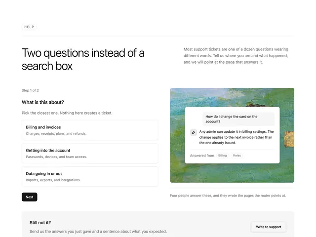

# Help section 'Two questions instead of a search box': step 1 of 2 with three bordered options and Next, beside a painting with a floating answer card

**Discipline:** web · **Design type:** Landing page sections
**Tags:** help, support, light-sans, steps, options, painting, chat-card, white

## What it is
A white page with a small HELP tag, a large light headline and a right paragraph, a left form with 'Step 1 of 2', a question 'What is this about?', three bordered option cards (Billing and invoices, Getting into the account, Data going in or out) and a black Next, a right image of a green-blue painting with a white card showing a sample question and answer with small tags, and a grey 'Still not it?' box with a Write to support button.

## What it means
Thoughtful and calm; two simple questions replace a search box and the painting adds warmth.

## Techniques
- Guide users with two steps instead of search.
- Use option cards with descriptions.
- Show a sample answer over a painting.
- Provide a fallback support box.

## Best for
- Support and help centres
- Guided routing forms
- Editorial minimal pages

## Vocabulary
- **Step form** — A form asking one question at a time.
- **Option card** — A bordered card with a title and description.
- **Answer preview** — A sample response shown in a card.
- **Fallback box** — A grey box offering another way to get help.
