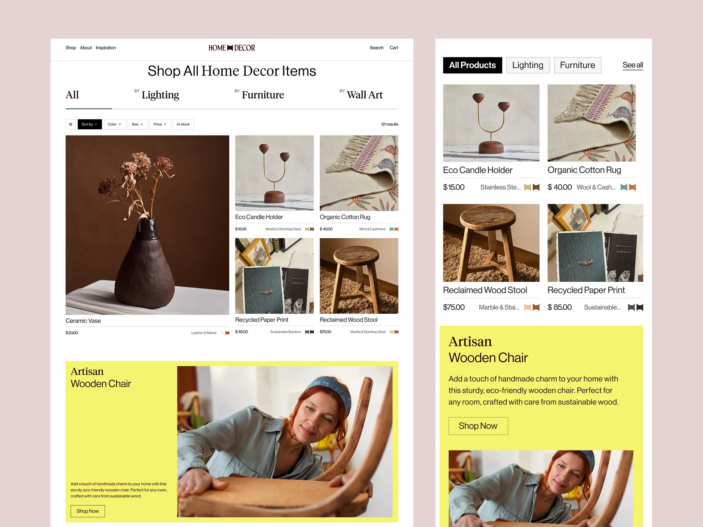

# Home-decor store: serif category tabs, mixed-size product grid and an acid-yellow artisan feature

**Discipline:** web · **Design type:** E-commerce storefront
**Tags:** e-commerce, home-decor, serif, dusty-pink, acid-yellow, product-grid, filters, feature-block

## What it is
On a dusty rose board, a desktop and a mobile view. A centred serif title 'Shop All Home Decor Items', serif tabs (All, Lighting, Furniture, Wall Art), a filter bar, a grid with one tall photo of a dark vase and smaller products with price and material lines and colour chips, and a full-width acid-yellow block 'Artisan Wooden Chair' with a craftsperson photo. The mobile view uses pill tabs and a two-column grid.

## What it means
Curated and crafted; serif and earthy photos with one acid-yellow jolt feel like a boutique.

## Techniques
- Use big serif category tabs with an underline.
- Make one product photo span two rows.
- Add colour chips beside price lines.
- Break the grid with an acid-yellow feature block.

## Best for
- Boutique home and craft stores
- Editorial e-commerce
- Responsive product grids

## Vocabulary
- **Tall feature tile** — A product photo spanning several rows.
- **Colour chip** — A small swatch showing product colour.
- **Category tab** — A large text label switching product groups.
- **Acid-yellow block** — A bright yellow full-width feature.
