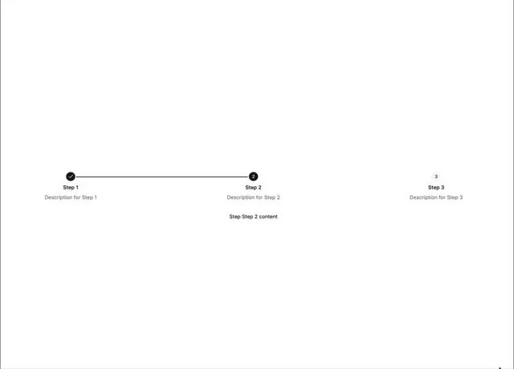

# Wide horizontal stepper with a black checked circle, a solid line to a black '2' circle and a pending grey '3', labels centred beneath

**Discipline:** web ·  · **Design style:** Dark & Neon
**Tags:** component, stepper, progress, line, black, grey, white, horizontal

## What it is
A white frame with three circles spaced far apart on a horizontal line: a black check, a black 2 joined by a solid black line and a pale grey 3 with no connecting line yet, each with a bold label and grey description centred below and a content line 'Step Step 2 content'.

## What it means
Clear and airy; a line that fills shows progress between steps.

## Techniques
- Join completed steps with a solid line.
- Leave the next segment empty.
- Centre labels under circles.
- Show content beneath.

## Best for
- Checkout and wizard steppers
- Progress trackers
- Minimal forms

## Vocabulary
- **Progress line** — A line connecting steps that fills as you advance.
- **Step circle** — A numbered or checked circle marking a step.
- **Centred label** — A title and description under a marker.
- **Wide stepper** — A stepper spread across the page width.
