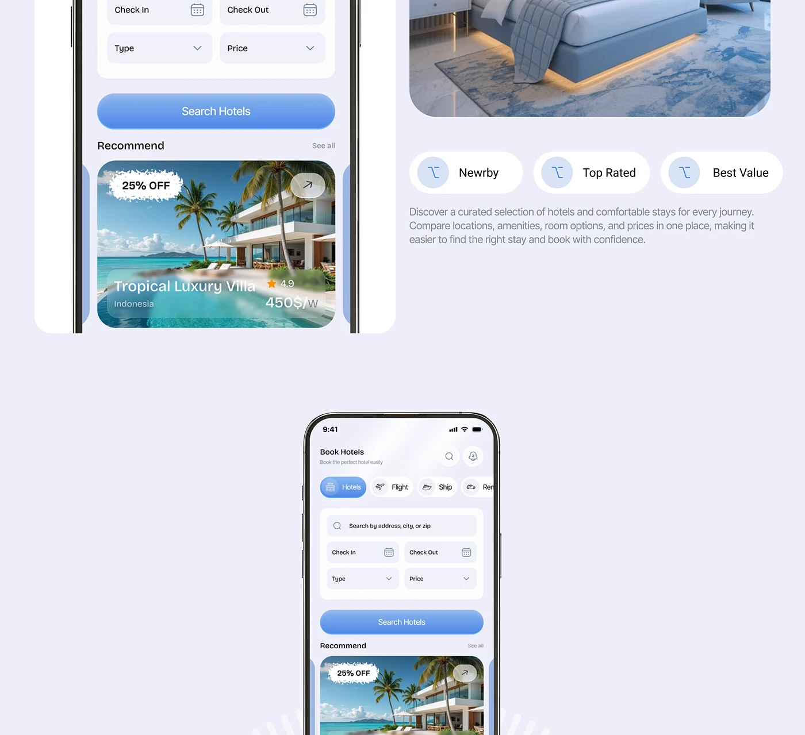

# Hotel Search Crop with Feature Chips

**Discipline:** web ·  · **Design style:** Playful & Illustrated
**Tags:** hotel, search, recommend, chips, blue, lavender, crop

## What it is
A cropped lavender page of a phone showing hotel search fields and a Recommend card with a 25% OFF torn sticker over a villa photo, a room photo, three pill chips (Nearby, Top Rated, Best Value) with icons and a paragraph, above a centred phone showing the same screen.

## What it means
Torn sticker and icon chips add friendly details to a clean form, and cropping suggests a longer scroll.

## Techniques
- Torn-edge discount sticker on a photo
- Icon circles inside pill chips
- Blue gradient search button
- Phones cropped by section edges
- Lavender panels with white cards

## Best for
- Hotel booking screens
- Feature chips beside device crops
- Cropped landing page sections

## Vocabulary
- **Torn sticker** — A label with rough torn edges placed over a photo.
- **Feature chip** — A pill with an icon naming a benefit.
- **Section crop** — A page fragment cut at the edges.
