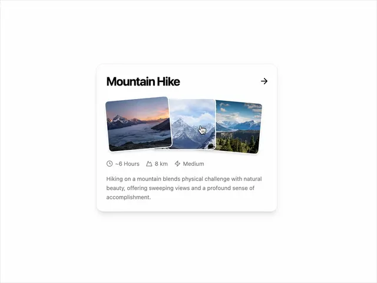

# White card 'Mountain Hike' with an arrow, three overlapping tilted mountain photos, a meta row (hours, km, difficulty) and a description

**Discipline:** web ·  · **Design style:** Geometric & Bauhaus
**Tags:** component, card, photo-fan, hover, white, meta-icons, travel, arrow

## What it is
A white rounded card with a soft shadow, a bold title and a right arrow, three slightly rotated overlapping mountain photos with white borders (one lifted under a cursor), a row of icons with '~6 Hours', '8 km', 'Medium' and a short grey paragraph.

## What it means
Inviting and tactile; fanned photos suggest a stack you can flip through.

## Techniques
- Fan overlapping photos with white borders.
- Lift the hovered photo.
- Add a compact icon meta row.
- Use a small arrow to indicate a link.

## Best for
- Travel and activity cards
- Hover photo stack components
- Card grids for experiences

## Vocabulary
- **Photo fan** — Overlapping tilted photos spread like cards.
- **Meta row** — Icons with small facts such as time and distance.
- **Hover lift** — An element rising when the cursor is over it.
- **Bordered photo** — A photo with a white frame.
