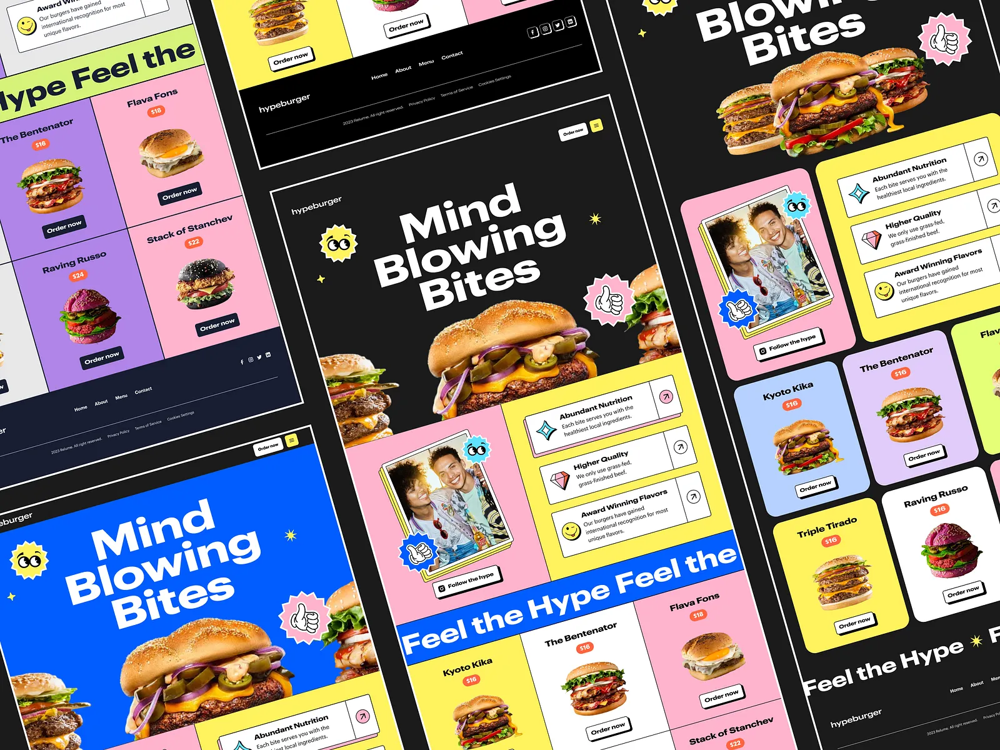

# Angled multi-colour burger site: black and blue heroes with 'Mind Blowing Bites', sticker badges, pink and yellow cards and pastel menu tiles

**Discipline:** web ·  · **Design style:** Playful & Illustrated
**Tags:** food, burger, black, blue, pink, yellow, stickers, tilted-layout

## What it is
A collage of the same site tilted across the frame: a black hero with a giant white 'Mind Blowing Bites' and a burger, a smiley-eyes sticker and thumbs-up badge, a pink card with a polaroid of two smiling people with sticker badges, yellow feature rows with arrow buttons, a blue 'Feel the Hype' banner, menu grids in pastel violet, blue, pink and yellow with burgers and dark Order Now buttons, and a black footer.

## What it means
Loud and playful; sticker badges and multi-colour tiles feel like street food culture.

## Techniques
- Use sticker badges like eyes and a thumbs-up.
- Alternate pastel product tiles.
- Set giant bold white headlines on black or blue.
- Present the layout tilted.

## Best for
- Food and burger brands
- Playful sticker-style sites
- Multi-colour menu grids

## Vocabulary
- **Sticker badge** — A scalloped circle with an icon.
- **Menu tile** — A pastel card with a dish and price tag.
- **Tilted collage** — Layouts rotated and cropped in one image.
- **Polaroid card** — A photo in a white-bordered frame.
