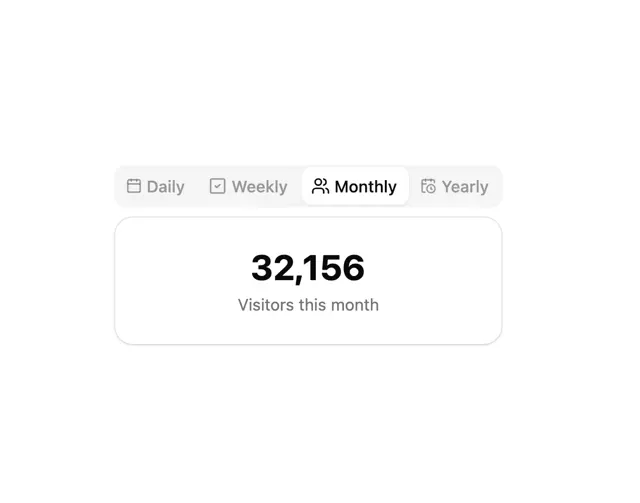

# Segmented tabs Daily, Weekly, Monthly (active) and Yearly with icons above a card '32,156 Visitors this month'

**Discipline:** web ·  · **Design style:** Geometric & Bauhaus
**Tags:** component, tabs, segmented, stat-card, white, grey, icons, numerals

## What it is
A white page with a grey rounded track of four icon tabs where Monthly is a white raised pill, and below a rounded bordered card with a large bold '32,156' and a grey caption 'Visitors this month'.

## What it means
Simple and tactile; the number swaps with the selected period.

## Techniques
- Pair icons with period labels.
- Raise the active tab.
- Show one big number below.
- Keep captions grey.

## Best for
- Time-range switchers
- Analytics stat cards
- Segmented tab components

## Vocabulary
- **Period tabs** — Tabs switching a metric's time range.
- **Raised pill** — The active tab shown as a white capsule.
- **Stat card** — A card with one big metric.
- **Caption** — A grey line describing a figure.
