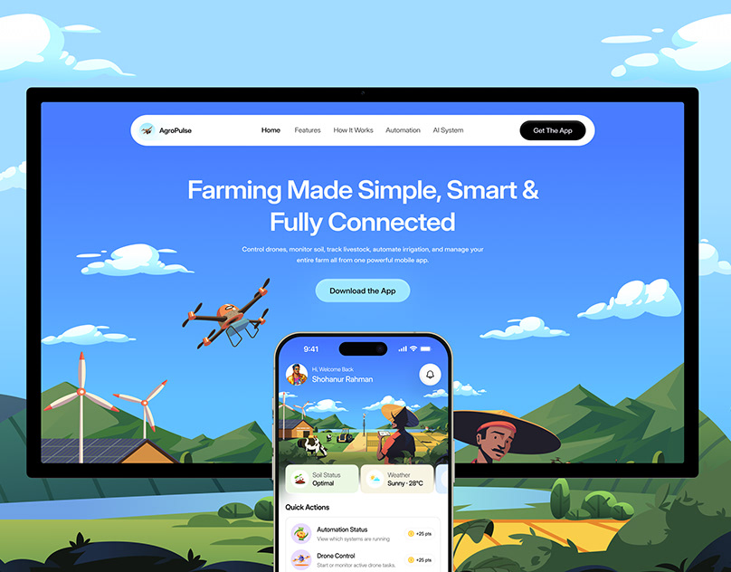

# Flat-illustrated farm landscape with a blue app hero on a monitor and a phone overlapping it

**Discipline:** web · **Design type:** Device mockup scene
**Tags:** illustration, farming, blue, green, landscape, monitor, phone, drone

## What it is
A bright flat-vector scene of hills, clouds, wind turbines and farmers. A monitor shows a blue hero 'Farming Made Simple, Smart & Fully Connected' with a floating drone and a pill nav, and a phone overlaps it with a farm dashboard.

## What it means
Friendly and optimistic; the illustrated world flows straight into the UI.

## Techniques
- Continue an illustrated landscape into the screen.
- Let a phone overlap the monitor.
- Use one blue hero with a drone illustration.
- Keep the UI pill nav clean.

## Best for
- Agritech and eco apps
- Illustration-led site presentations
- Friendly explainer heroes

## Vocabulary
- **Flat vector scene** — An illustration in flat shapes without outlines.
- **Scene continuity** — A backdrop that matches the screen imagery.
- **Overlapping devices** — A phone placed over a monitor.
- **Illustrated hero** — A hero built from drawings.
