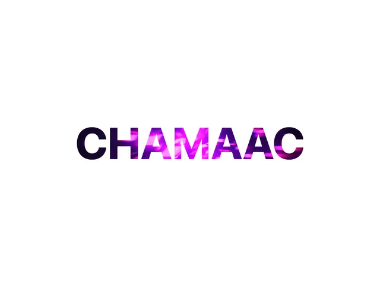

# White page with the heavy word 'CHAMAAC' filled with a magenta and violet liquid image, dark at the ends and bright in the middle

**Discipline:** web · **Design type:** Motion text
**Tags:** typography, image-fill, purple, magenta, white, heavy-caps, masked-text, minimal

## What it is
A pure white frame with a centred heavy sans 'CHAMAAC' whose letters are masked with a glossy purple-magenta fluid image, darker indigo at the outer letters and brighter pink in the middle ones.

## What it means
Vivid and modern; image-filled letters make a plain word feel liquid.

## Techniques
- Mask heavy letters with an image.
- Let the fill shift in tone across the word.
- Keep the background pure white.
- Use tight letter spacing.

## Best for
- Hero wordmarks and titles
- Text-as-mask effects
- Minimal brand reveals

## Vocabulary
- **Image-filled text** — Letters masked with a photograph or texture.
- **Fluid texture** — A glossy liquid-like image.
- **Heavy sans** — A very bold sans-serif.
- **Tonal shift** — A gradual change of brightness across a shape.
