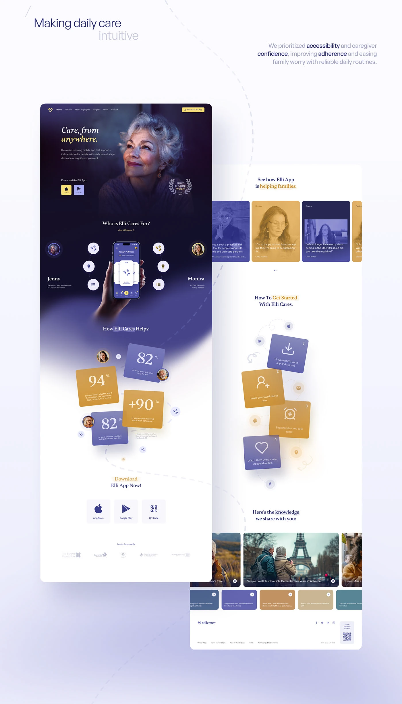

# Indigo and Gold Care App Landing Page

**Discipline:** web ·  · **Design style:** Editorial
**Tags:** care, indigo, gold, long-page, serif, cards, testimonials, tilted-tiles

## What it is
A presentation of a long landing page with a dark indigo hero of a smiling older woman under a serif italic headline, a persona ring around a phone, tilted stat tiles in gold and indigo, testimonial cards, a how-to-start steps section with tilted tiles and a knowledge cards row and footer, shown as two offset pages under a headline about accessibility.

## What it means
Warm gold on deep indigo feels trustworthy and gentle, and tilted tiles add life to statistics.

## Techniques
- Indigo to white gradient down the page
- Tilted square stat tiles in gold and indigo
- Persona avatars orbiting a central phone
- Serif italic for warm headings
- Duotone photo cards for reviews

## Best for
- Health and care service websites
- Emotional, human-centred landing pages
- Presenting long pages as offset panels

## Vocabulary
- **Tilted tile** — A square card rotated slightly for energy.
- **Duotone card** — A photo card tinted in two brand colours.
- **Offset pages** — Two page screenshots staggered in one presentation.
