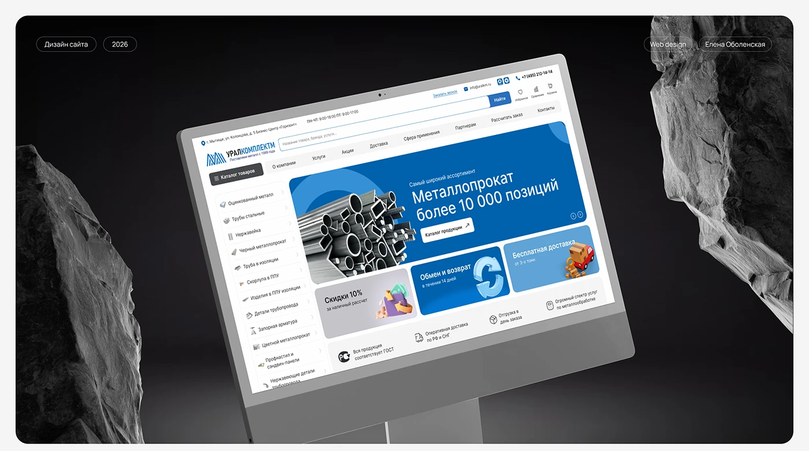

# Industrial catalog site shown on a monitor between dark rocks

**Discipline:** web ·  · **Design style:** 3D & Surreal
**Tags:** e-commerce, catalog, industrial, blue, 3d-icons, mockup, cyrillic, mega-menu

## What it is
A metal-supplier website on a tilted monitor against dark grey rocks. The UI has a top bar, search, a left category list, a large blue promo banner with steel pipes, and smaller tiles with glossy 3D icons for discounts, returns and delivery.

## What it means
Reliable, dense and practical, the kind of interface built for professionals who need to find things fast; the monochrome stage makes the blue pop.

## Techniques
- Show a busy catalog UI in a monochrome stylised scene so the brand blue is the only colour.
- Use glossy 3D icons in benefit tiles to add friendliness to a utilitarian page.
- Keep a left category tree beside a hero banner to balance browsing and promotion.
- Repeat one blue for banner, buttons and links.

## Best for
- B2B catalogs and industrial suppliers
- Marketplaces with deep category trees
- Portfolio presentations of large sites

## Vocabulary
- **Mega catalog** — A site with a large hierarchical product list.
- **3D icon** — A glossy rendered pictogram.
- **Promo tile** — A small banner promoting one offer.
- **Stage mockup** — Presenting a design in a dramatic set.
