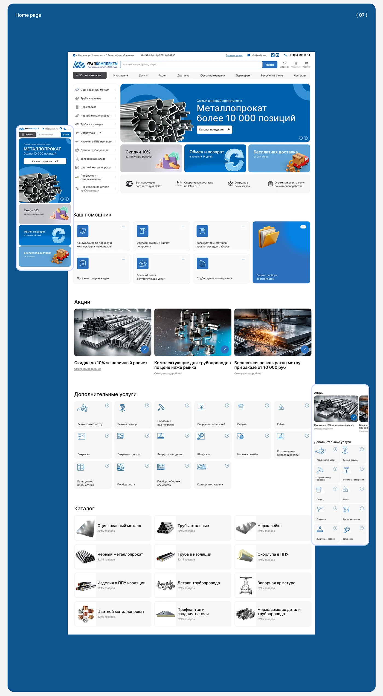

# Deep blue board with a long metal-supplier home page: category tree, promo banner, services grid, offers and catalog, plus a mobile view

**Discipline:** web ·  · **Design style:** Geometric & Bauhaus
**Tags:** e-commerce, catalog, blue, industrial, home-page, mobile, icons-grid, cyrillic

## What it is
A deep blue rounded board '(07) Home page' with a tall white desktop page: contact bar, logo and search, a left category tree beside a large blue banner with steel pipes, three promo tiles (grey, blue, light blue) with 3D icons, a benefit row, a helper section of six tool tiles and a blue feature tile, three offer photos, a grid of additional services icons, and a catalog of category cards; a mobile hero and a services list overlap the edges.

## What it means
Dense but orderly; blue and white keep a big catalogue readable.

## Techniques
- Combine a category tree with a large hero banner.
- Use 3D icons in promo tiles.
- Show services as a grid of line-icon tiles.
- Overlap mobile views on the board.

## Best for
- Large B2B catalogue sites
- Industrial supply home pages
- Blue-white e-commerce

## Vocabulary
- **Category tree** — A vertical list of product categories.
- **Promo tile** — A small banner for an offer.
- **Service icon tile** — A tile with a line icon and label.
- **Overlapping mobile** — Phone views placed over a board edge.
