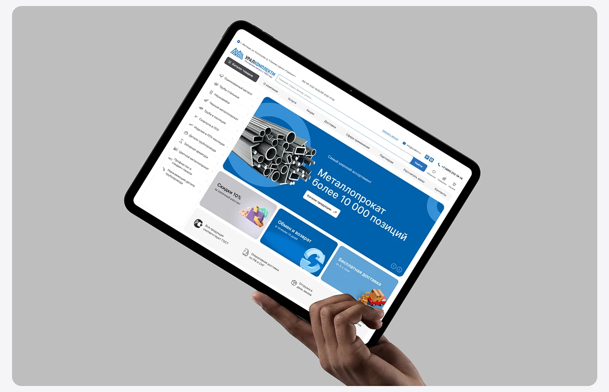

# Metal-supplier homepage on a tablet tilted in a hand against neutral grey

**Discipline:** web · **Design type:** Device mockup scene
**Tags:** tablet, mockup, hand, blue, grey, industrial, hero-banner, cyrillic

## What it is
A hand holds a tablet at a steep angle in front of a mid-grey rounded panel; the screen shows a blue hero with steel bars, promo tiles for discounts, returns and delivery, and a category list.

## What it means
Practical and confident; the tilt gives dynamism to a plain catalogue.

## Techniques
- Tilt the device sharply for energy.
- Use a flat grey backdrop.
- Show hero banner plus promo tiles.
- Let the hand overlap the bottom edge.

## Best for
- B2B catalogue showcases
- Device-in-hand covers
- Neutral mockup scenes

## Vocabulary
- **Steep tilt** — A device angled strongly in frame.
- **Flat grey stage** — A plain neutral backdrop.
- **Promo tile** — A small banner for an offer.
- **Category list** — A vertical menu of product groups.
