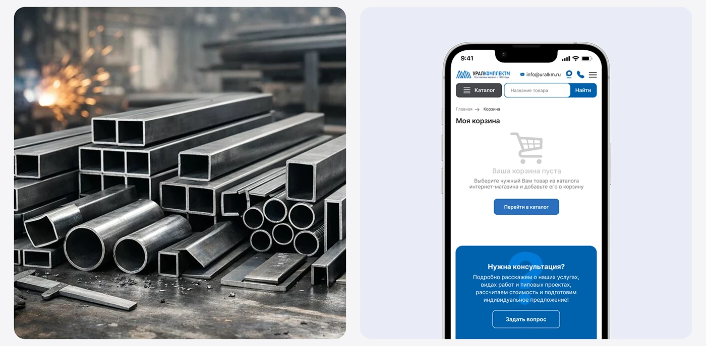

# Industrial catalog mobile cart beside moody steel photograph

**Discipline:** web · **Design type:** Responsive mobile web
**Tags:** mobile-web, empty-state, cart, blue, steel, photography-pairing, cyrillic

## What it is
A split tile: on the left a dark photo of steel pipes and sparks in a workshop, on the right a phone showing an empty-cart state with a grey icon, a blue button, and a deep blue consultation card.

## What it means
Practical and trustworthy; the gritty photo grounds the clean interface in real materials.

## Techniques
- Pair a real-world product photo with the matching UI to connect brand and interface.
- Design an empty state with a light icon, one sentence and one blue button.
- Close the page with a saturated blue call-to-action card.
- Keep the interface light and airy against a dark image.

## Best for
- Industrial and B2B e-commerce
- Portfolio slides explaining mobile states
- Empty and error state design

## Vocabulary
- **Empty state** — The screen shown when there is no content yet.
- **Photo-UI pairing** — Placing photography next to interface to show context.
- **CTA card** — A coloured block containing a prompt and one button.
- **Material photography** — Close images of a product's raw materials.
