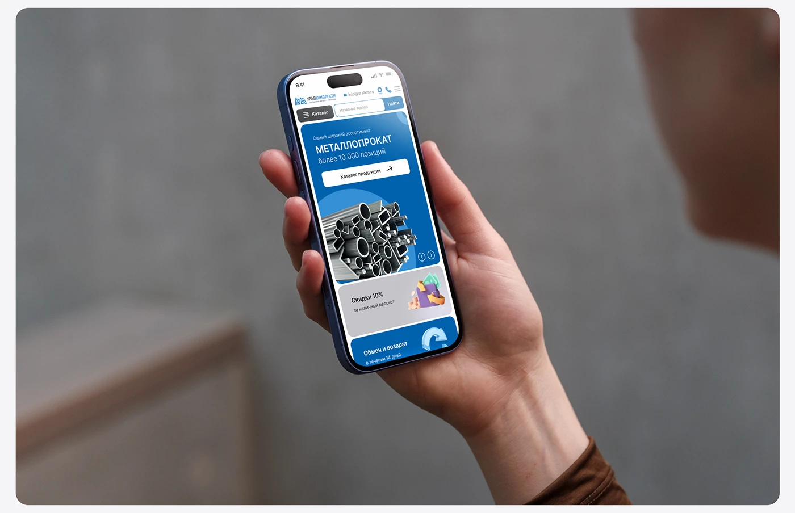

# Metal-supplier mobile home page held in a hand against grey concrete

**Discipline:** web · **Design type:** Device mockup scene
**Tags:** mobile-web, mockup, hand, blue, concrete, industrial, hero, carousel

## What it is
A rounded frame with a blurred grey concrete room and a hand holding a phone tilted towards the viewer. The screen shows a blue hero card with a metal pipes photo, a white CTA, a grey discount card with a 3D wallet icon and a blue returns card.

## What it means
Practical and trustworthy; a real hand and quiet background make the site feel usable.

## Techniques
- Tilt the phone in a hand against a neutral out-of-focus room.
- Use blue banner cards with a real material photo.
- Pair secondary cards with 3D icons.
- Frame the image in a rounded card.

## Best for
- B2B and industrial mobile sites
- Case study photography
- Utilitarian brands wanting human warmth

## Vocabulary
- **Neutral backdrop** — A blurred grey background that keeps focus on the device.
- **Hero card** — A large card at the top of a mobile page.
- **3D icon card** — A card with a rendered icon.
- **Rounded frame** — A softly cornered container.
