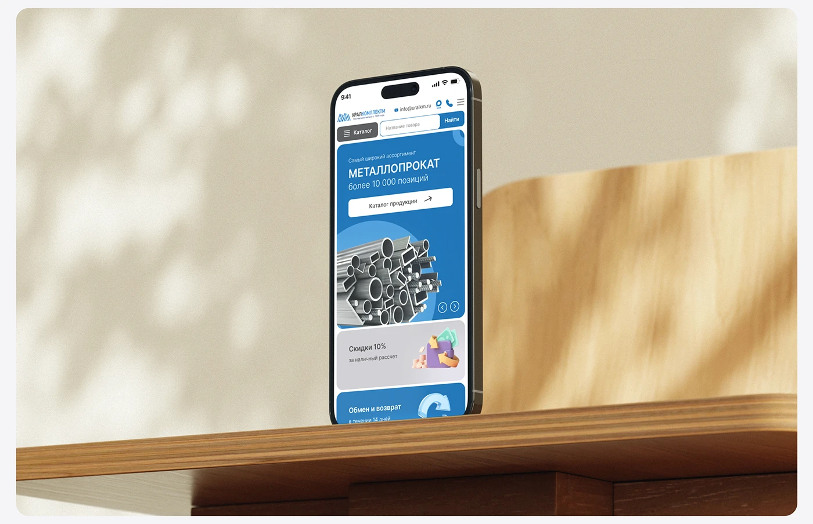

# Metal-supplier mobile homepage on a phone standing on a wooden shelf against dappled beige light

**Discipline:** web · **Design type:** Device mockup scene
**Tags:** mobile-web, mockup, wood, beige, dappled-light, blue, industrial, shelf

## What it is
A phone stands upright on the edge of a wooden shelf against a beige wall with soft leaf shadows and a wooden chair back, in a rounded frame. The screen shows a blue hero with metal profiles and offer cards.

## What it means
Warm and natural; wood and light soften an industrial catalogue.

## Techniques
- Stand the phone on a shelf edge.
- Use dappled light shadows.
- Choose warm neutral surroundings.
- Frame in a rounded card.

## Best for
- Industrial and B2B mobile mockups
- Warm-neutral scenes
- Case study images

## Vocabulary
- **Shelf-edge mockup** — A device standing at a shelf edge.
- **Dappled shadow** — Leaf-like shadow patterns.
- **Warm neutral** — Beige and wood tones.
- **Contrast pairing** — Blue UI against warm surroundings.
