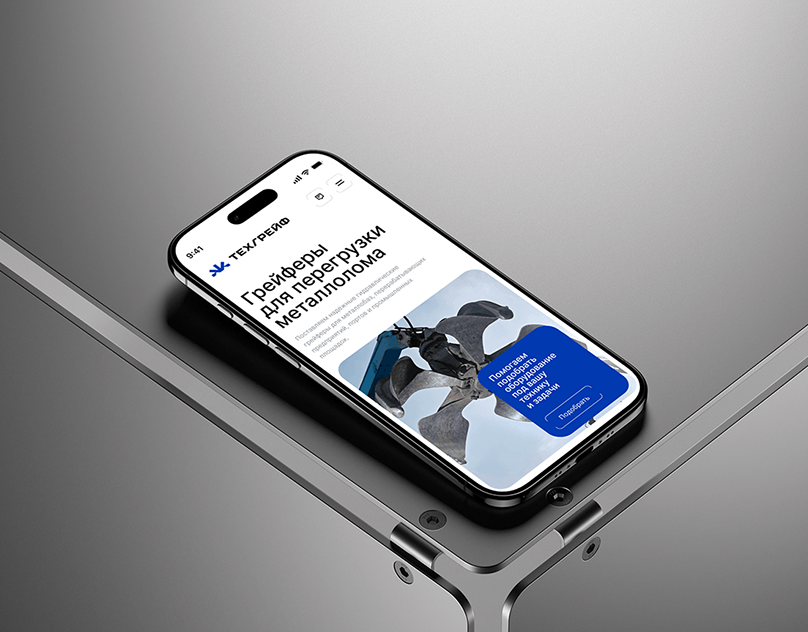

# Industrial Mobile Site on Steel Frame (Small)

**Discipline:** web · **Design type:** Device mockup scene
**Tags:** mobile-web, steel, grey, industrial, blue, isometric, cover

## What it is
A phone lying on a brushed steel frame showing a mobile site with a Cyrillic headline about scrap-metal grapples, a photo card and a blue call-out card.

## What it means
Cool metal surroundings match the heavy-industry subject, and the royal-blue card gives one confident accent.

## Techniques
- Product context reflected in the mockup material (metal)
- Isometric angle with diagonal frame lines
- Single saturated blue block on a white page
- Large stacked headline with a smaller subtitle
- Grey gradient studio background

## Best for
- Industrial and B2B websites
- Responsive design showcases
- Case-study cover images

## Vocabulary
- **Material matching** — Choosing a scene material that reflects the subject.
- **Callout card** — A coloured card on a photo carrying a short message.
- **Isometric angle** — A three-quarter view with parallel lines on diagonals.
