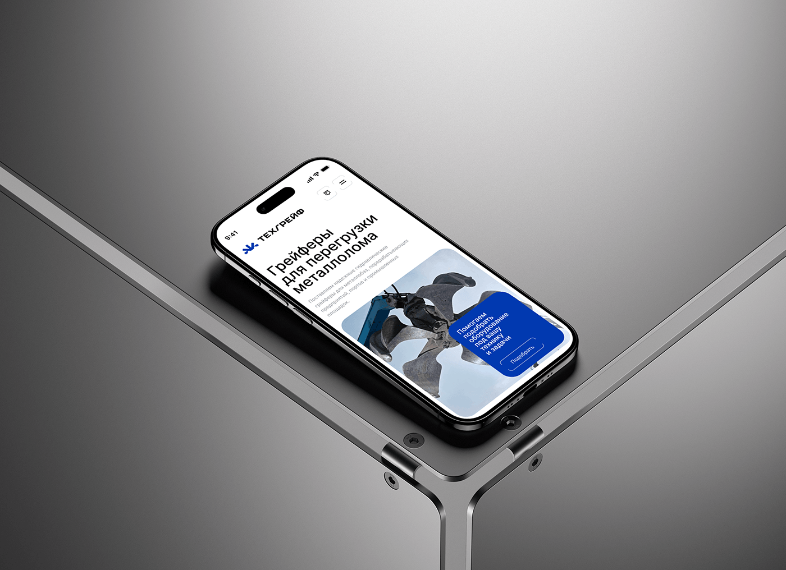

# Industrial Mobile Site on Steel Frame

**Discipline:** web ·  · **Design style:** Neo-Brutalist
**Tags:** mobile-web, steel, grey, industrial, blue, isometric, hero

## What it is
A high-resolution shot of a phone lying on a steel-framed surface showing a Cyrillic mobile landing page for metal grapples, with a hero photo and a royal-blue card with an outlined button.

## What it means
Reflective metal, hard shadows and a single blue block create a precise, engineered mood.

## Techniques
- Phone set on reflective metal with hard shadows
- Stacked bold headline followed by muted body text
- Blue card overlapping the hero photo corner
- Cropped nav with icon buttons
- Cool gradient backdrop lightening toward the top

## Best for
- Machinery and B2B supplier sites
- Mobile-first showcase images
- Engineering-led brands

## Vocabulary
- **Hero photo card** — A rounded photo as the main visual of a mobile hero.
- **Hard shadow** — A crisp-edged shadow suggesting strong directional light.
- **Outlined button** — A button with only a border, used as a secondary action.
