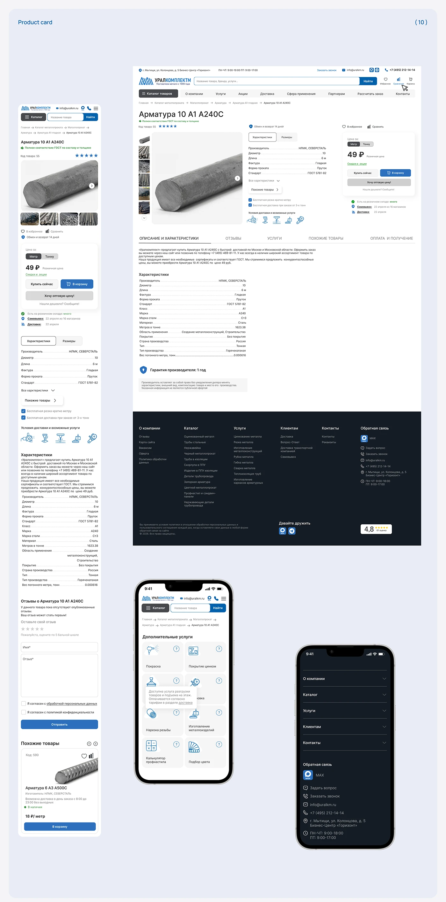

# Product detail page for a catalog site: desktop, mobile and dark footer

**Discipline:** web ·  · **Design style:** Corporate & Clean-Tech
**Tags:** product-page, catalog, blue, tabs, specs-table, mobile, footer, cyrillic

## What it is
A lilac-blue board titled 'Product card' with a long desktop product page (gallery with thumbnails, key facts, price box with two buttons, tabs, specification table, warranty note, dark navy footer with columns), a long mobile version and two more phone screens for extra services and an expanded menu.

## What it means
Thorough and dependable; ordered tables and consistent blue actions convey professional supply.

## Techniques
- Split product info into a gallery, facts and a sticky price box.
- Use tabs under the fold to divide description, reviews, services and delivery.
- Present specs as a two-column table with hairlines.
- End with a dark navy multi-column footer for contrast.
- Show the mobile page as one long scroll next to smaller state screens.

## Best for
- B2B and technical e-commerce
- Design-system documentation of PDPs
- Sites with detailed specifications

## Vocabulary
- **PDP** — Product detail page.
- **Spec table** — A two-column list of attributes and values.
- **Price box** — A panel holding price, unit toggle and buy buttons.
- **Tab bar** — Horizontal labels switching content sections.
