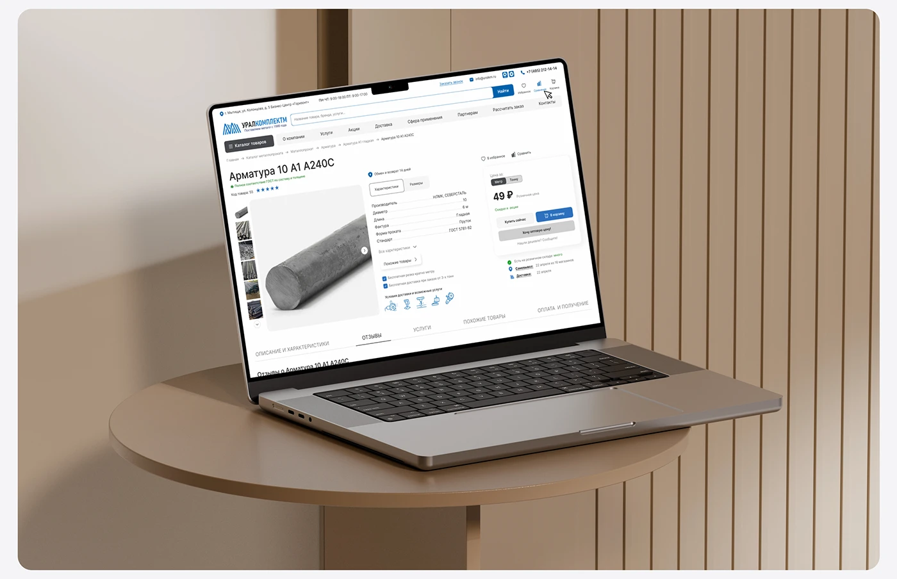

# Steel-bar product detail page on a laptop on a round table against wood slat wall

**Discipline:** web ·  · **Design style:** Warm & Organic
**Tags:** laptop-mockup, product-page, wood, beige, industrial, round-table, warm, rounded-frame

## What it is
A laptop showing a white product page for a steel reinforcing bar sits on a round taupe table in front of a vertical wood-slat wall in warm beige light, framed by rounded corners.

## What it means
Warm and orderly; wood tones soften a technical page.

## Techniques
- Place the laptop on a round table.
- Use vertical slat backdrop.
- Warm neutral lighting.
- Frame in rounded card.

## Best for
- B2B product page presentations
- Warm interior scenes
- Catalogue site covers

## Vocabulary
- **Slat wall** — A wall of vertical wood slats.
- **Round table stage** — A circular table used as a stand.
- **Warm neutral** — Beige and taupe tones.
- **Product page** — A page detailing one item.
