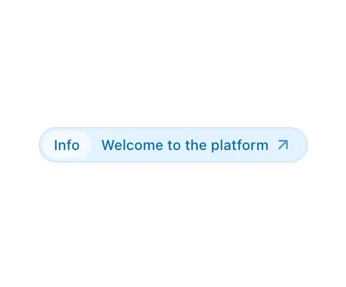

# Pale blue pill badge 'Info | Welcome to the platform ↗' with a lighter inner tag and a diagonal arrow

**Discipline:** web · **Design type:** UI components
**Tags:** component, badge, pill, blue, announcement, arrow, soft, ui-kit

## What it is
A single sky-blue capsule with a subtle border and soft shadow: an inner lighter pill 'Info', the message 'Welcome to the platform' and a small diagonal arrow, all in mid-blue text.

## What it means
Gentle and informative; tonal blues make a notice feel calm.

## Techniques
- Nest a lighter tag inside a tinted capsule.
- Colour text and border from the same hue.
- End with a diagonal arrow.
- Add a faint shadow.

## Best for
- Announcement and status badges
- Info banners
- Tonal component sets

## Vocabulary
- **Announcement pill** — A capsule with a short message and arrow.
- **Inner tag** — A lighter label nested in a pill.
- **Tonal colouring** — Text, fill and border from one hue.
- **Diagonal arrow** — An arrow pointing up and right to indicate a link.
