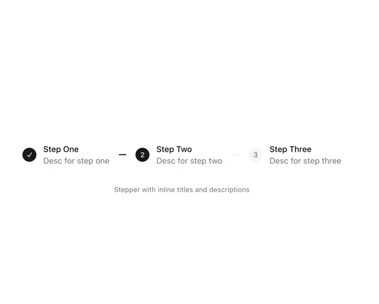

# Three-step stepper with a checked black circle, an active numbered circle and a pale pending circle, titles and descriptions inline

**Discipline:** web ·  · **Design style:** Minimalist
**Tags:** component, stepper, progress, black, grey, white, minimal, inline-labels

## What it is
A white frame with three steps in a row, each a circle followed by a title and a grey description: Step One with a black check, Step Two with a black '2', Step Three with a pale grey '3', joined by short dashes, with a small caption 'Stepper with inline titles and descriptions'.

## What it means
Clear and lightweight; contrast alone shows done, current and pending.

## Techniques
- Show done as a filled check.
- Show current as a filled number.
- Fade pending steps.
- Keep labels inline beside circles.

## Best for
- Onboarding and checkout steppers
- Progress indicators
- Minimal form flows

## Vocabulary
- **Stepper** — A control showing progress through steps.
- **Completed state** — A step marked with a check.
- **Pending state** — A step shown in pale grey.
- **Inline label** — A title and description beside its marker.
