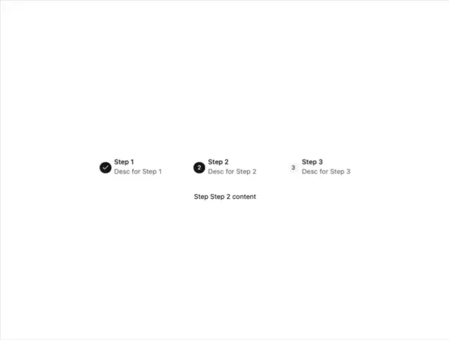

# Three-step stepper: check, active '2' and pending '3' with bold titles and grey descriptions, and a content line 'Step Step 2 content'

**Discipline:** web · **Design type:** UI components
**Tags:** component, stepper, progress, black, grey, white, minimal, inline

## What it is
A white frame with three steps across: a black check circle with 'Step 1' and grey description, a black '2' circle with 'Step 2' and a pale grey '3' circle with 'Step 3', and a centred line below with the current step's content.

## What it means
Straightforward; the row shows progress and the line below shows the active content.

## Techniques
- Mark done with a check.
- Mark active in black.
- Fade pending steps.
- Show content under the stepper.

## Best for
- Multi-step forms
- Onboarding steppers
- Minimal UI kits

## Vocabulary
- **Stepper** — A control showing steps in a process.
- **Active step** — The current step, filled in black.
- **Step content** — The panel content for the current step.
- **Pending step** — An upcoming step shown in pale grey.
